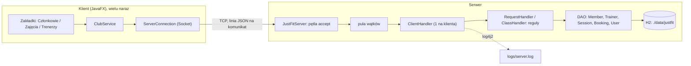

# Architektura JustFit (materiał do obrony)

## Schemat

## Przepływ jednego zapisu na zajęcia

1. Recepcjonistka klika „Zapisz członka”; `SessionsTab` woła `ClubService.book(...)` w wątku w tle (`Ui.run`), żeby okno się nie zawieszało.
2. `ServerConnection` wysyła jedną linię: `{"action":"BOOK","data":{"sessionId":3,"memberId":7}}`.
3. Serwer: `ClientHandler` (wątek tego klienta) czyta linię, `RequestHandler` sprawdza, czy użytkownik jest zalogowany, `ClassHandler` przekazuje do `BookingDao.book`.
4. `BookingDao.book` w bloku `synchronized`: limit miejsc, duplikat, przeszłość, ważność karnetu, potem INSERT.
5. Odpowiedź `{"ok":true,...}` albo `{"ok":false,"error":"Brak wolnych miejsc"}`; klient odświeża grafik.

## Pytania, które mogą paść

| Pytanie | Odpowiedź |
|---|---|
| Jak serwer obsługuje wielu klientów? | Jeden wątek akceptujący połączenia + pula wątków; każdy klient ma własny `ClientHandler`. |
| Co jeśli dwie osoby zapiszą się na ostatnie miejsce? | Sprawdzenie i zapis są w sekcji `synchronized` (wspólny `LOCK` w `BookingDao`); test `ClassesDaoTest` odpala 12 wątków na 3 miejsca i sprawdza, że zajętych jest dokładnie 3. Wystarcza, bo działa jeden proces serwera. |
| Dlaczego JSON po gniazdach, a nie RMI/HTTP? | Wymaganie to gniazda; JSON z jedną linią na komunikat jest prosty, czytelny w logach i łatwy do testowania. |
| Dlaczego H2? | Baza w jednym pliku, bez instalacji, działa wszędzie; w testach baza w pamięci. |
| Jak są chronione hasła? | BCrypt (jBCrypt), w bazie tylko hash. |
| Jak uruchomić na innym komputerze? | `java -jar justfit.jar` (Java 21), jeden plik. |
| Jak działają logi? | Log4j2 do `logs/*.log` z rotacją (5 MB); okno serwera pokazuje te same logi na żywo (własny appender). |
| Co testujecie? | DAO i reguły (`DaoTest`, `ClassesDaoTest`), protokół (`ProtocolTest`, `RequestHandlerTest`, `ClassHandlerTest`), prawdziwe gniazda z wieloma klientami (`ServerIntegrationTest`), klient na sztucznym serwerze (`ClubServiceTest`). |
| Co byś rozbudował? | Konta członków z samodzielnymi zapisami, listę oczekujących, przypomnienia, obecność. |
